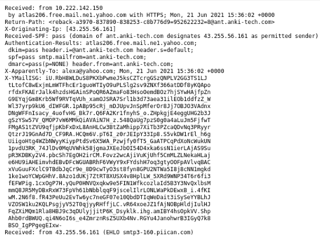
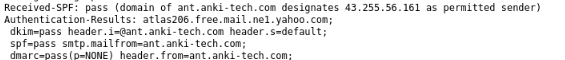

# Investigation Screenshots

The following screenshots document the evidence collected during the phishing email investigation.
## 1. Email Headers

## 2. Email Authentication

## 3. Sender Domain - VirusTotal

## 4. Promotional URL - VirusTotal

## 5. Image-Hosting Domain - VirusTotal

